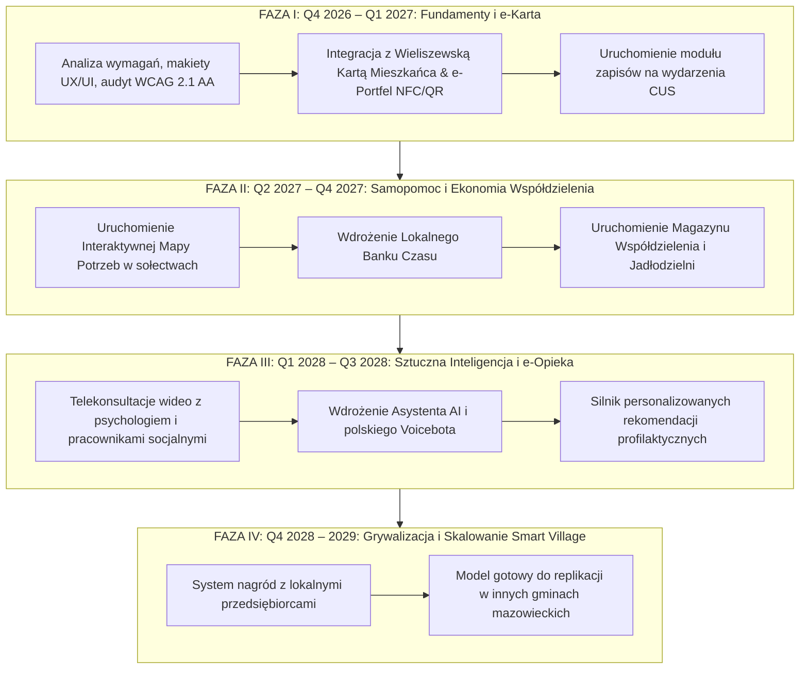

# Kosztorys i Harmonogram Wdrożenia Projektu
## Smart CUS & AI – Gmina Wieliszew (Budżet całkowity: 1 500 000 zł)
**Okres realizacji:** 2026 – 2029  
**Źródła finansowania:** Środki własne Gminy Wieliszew, fundusze unijne (FEnIKS / Fundusze Europejskie dla Mazowsza 2021-2027), programy wsparcia Smart Village i polityki senioralnej.

---

## 1. Zestawienie Kosztów wg Modułów i Działań (WBS)

| Kod WBS | Kategoria / Etap prac | Koszt (PLN brutto) | % Budżetu |
| :--- | :--- | :--- | :--- |
| **WBS 1.0** | **Prace analityczne, architektura i audyt dostępności** | **120 000 zł** | **8.0%** |
| 1.1 | Badania z mieszkańcami (user research, wywiady z seniorami, NGO) | 35 000 zł | |
| 1.2 | Studium wykonalności, analiza prawna RODO i KRI | 45 000 zł | |
| 1.3 | Audyt dostępności wstępnej WCAG 2.1 AA i testy z użytkownikami ze szczególnymi potrzebami | 40 000 zł | |
| **WBS 2.0** | **Platforma Backend, Szyna Integracyjna i Bezpieczeństwo** | **340 000 zł** | **22.7%** |
| 2.1 | API Gateway, szyna wymiany danych (ESB), mikroserwisy | 140 000 zł | |
| 2.2 | Integracja z systemem Wieliszewskiej Karty Mieszkańca (WKM) | 90 000 zł | |
| 2.3 | Moduł anonimizacji RODO i konektor do systemów CUS (TT-Pomoc / Pomost) | 60 000 zł | |
| 2.4 | Infrastruktura chmurowa, środowiska HA i certyfikowane audyty cyberbezpieczeństwa | 50 000 zł | |
| **WBS 3.0** | **Rozwój Aplikacji Mobilnej Android (Native Kotlin/Compose)** | **520 000 zł** | **34.7%** |
| 3.1 | Core Android: Architektura, Design System Wieliszew, Tryb Seniora | 75 000 zł | |
| 3.2 | Moduł e-Wieliszewska Karta Mieszkańca (NFC HCE + dynamiczny QR TOTP) | 65 000 zł | |
| 3.3 | Moduł Interaktywna Mapa Potrzeb i Mikrowolontariatu (GPS, filtry sołectw) | 80 000 zł | |
| 3.4 | Moduł Lokalnego Banku Czasu (Wymiana umiejętności, ledger punktów) | 70 000 zł | |
| 3.5 | Moduł Grywalizacji i Nagród Mieszkańca (katalog benefitów, integracja z partnerami) | 60 000 zł | |
| 3.6 | Moduł Telekonsultacji i e-Wsparcia (WebRTC wideo/audio, wirtualna poczekalnia) | 90 000 zł | |
| 3.7 | Moduł Cyfrowego Współdzielenia (wypożyczalnia sprzętu, jadłodzielnia, odzież) | 80 000 zł | |
| **WBS 4.0** | **Silnik Wirtualnego Asystenta AI i Personalizacji** | **230 000 zł** | **15.3%** |
| 4.1 | Wdrożenie modelu językowego RAG z bazą wiedzy CUS Wieliszew | 110 000 zł | |
| 4.2 | Integracja polskiego Voicebota (Speech-to-Text / Text-to-Speech) | 70 000 zł | |
| 4.3 | Silnik inteligentnych rekomendacji prozdrowotnych i kulturalnych | 50 000 zł | |
| **WBS 5.0** | **Wdrożenie, Szkolenia, Aktywizacja Mieszkańców i Promocja** | **170 000 zł** | **11.3%** |
| 5.1 | Cykl warsztatów cyfrowych dla seniorów w sołectwach (Wieliszew, Skrzeszew, Komornica...) | 65 000 zł | |
| 5.2 | Szkolenia personelu CUS, pracowników socjalnych, partnerów biznesowych | 45 000 zł | |
| 5.3 | Kampania informacyjno-edukacyjna ("Wieliszew w Twoim telefonie") | 60 000 zł | |
| **WBS 6.0** | **Utrzymanie, SLA, Rozwój i Gwarancja (2027–2029)** | **120 000 zł** | **8.0%** |
| 6.1 | Nadzór techniczny, poprawki bezpieczeństwa, aktualizacje Android SDK | 80 000 zł | |
| 6.2 | Dalsze dostosowywanie modelu w oparciu o zebrane dane Smart Village | 40 000 zł | |
| **RAZEM**| **CAŁKOWITY KOSZT PROJEKTU** | **1 500 000 zł** | **100%** |

---

## 2. Harmonogram Realizacji (2026–2029)

---

## 3. Kluczowe Wskaźniki Sukcesu (KPI)
1. **Liczba aktywnych użytkowników e-Karty w smartfonie:** Minimum 4 000 mieszkańców Gminy Wieliszew do końca 2027 r.
2. **Aktywność w mikrowolontariacie:** Ponad 1 200 zrealizowanych drobnych form wsparcia rocznie na Mapie Potrzeb.
3. **Wymiana w Banku Czasu:** Co najmniej 800 wymienionych godzin usług w pierwszym roku działania modułu.
4. **Wskaźnik dostępności dla seniorów:** Ponad 60% seniorów biorących udział w pilotażu deklaruje łatwość obsługi aplikacji dzięki trybowi asysty i voicebotowi.
5. **Redukcja wykluczenia komunikacyjnego:** Realizacja min. 500 telekonsultacji rocznie dla osób o ograniczonej mobilności.

